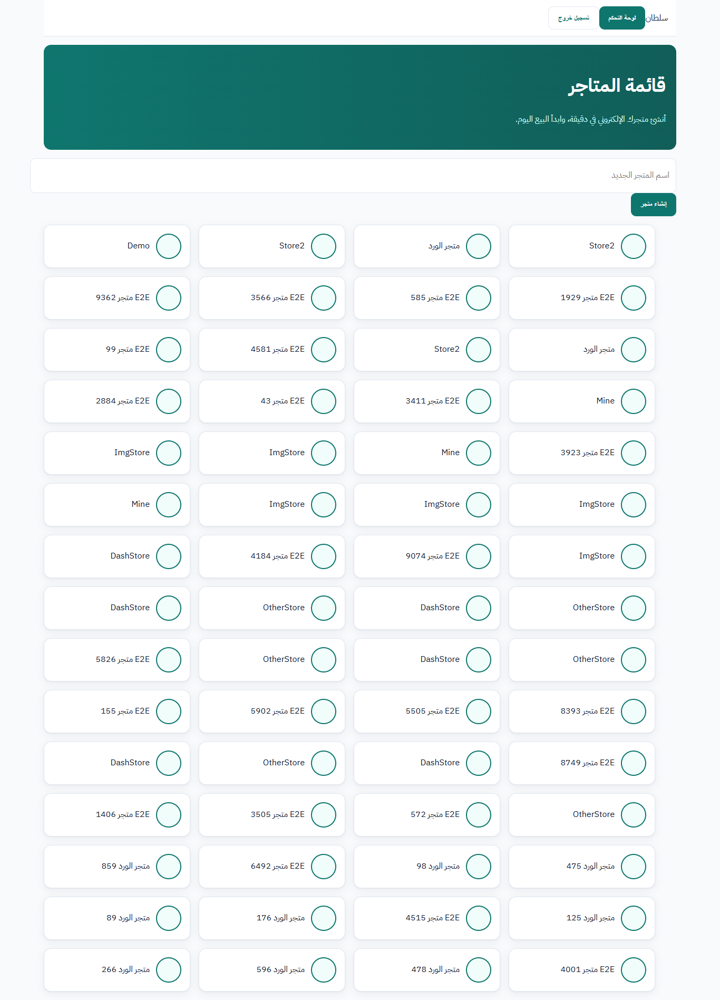
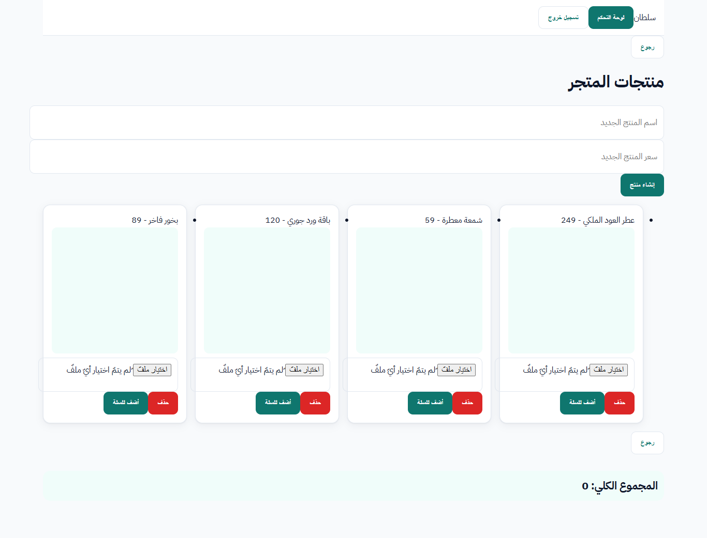
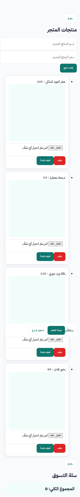

# salla-clone

**متجر إلكتروني بفكرة سلة: متاجر، منتجات بصور، سلة، طلبات، دفع تجريبي، ولوحة تحكم للتاجر**

An e-commerce demo inspired by Salla: stores, products with photos, cart, orders, mock payment, owner dashboard.

> مشروع تعليمي/تجريبي — ليس تابعاً لأي علامة تجارية حقيقية، ولا يستخدم أي شعار أو كود منها. الدفع وهمي بالكامل.
> Educational demo. Not affiliated with any real brand; no logos or code copied. Payments are mock only.

## لقطات الشاشة / Screenshots

| سطح المكتب / Desktop | الجوال / Mobile |
|---|---|
|  |  |
|  |  |

## التقنيات / Stack

- Server: Node.js, Express 4, better-sqlite3 (SQLite), bcryptjs, JWT (jsonwebtoken), multer (image uploads: PNG/JPEG/WEBP, 2 MB, checked by file signature)
- Client: React 18 + Vite 5, Arabic RTL, IBM Plex Sans Arabic (self-hosted via @fontsource), plain CSS (no framework)

## التشغيل محلياً / Run locally

```bash
# 1) server (port 5000)
cd server
npm install
cp .env.example .env    # then set JWT_SECRET (or export JWT_SECRET=...)
npm start

# 2) client (port 5173, proxies /api and /uploads to :5000)
cd ../client
npm install
npm run dev
```

Open http://localhost:5173

- `JWT_SECRET`: read from the environment. If it is missing, a random secret is generated into a local, git-ignored file for development only.
- Data is stored in a local SQLite file under `server/data/` (git-ignored). Uploaded images go to `server/uploads/` (git-ignored).

## الاختبارات / Tests

End-to-end browser test (needs the server and client running, and Google Chrome):

```bash
cd tests
npm install
CHROME_PATH="/path/to/chrome" npm test
```

## منهجية العمل / Method

- Briefs written with the RCTC method (Role, Context, Task, Constraints + evidence) — https://github.com/kazoya/rctc-skill
- UI reviewed against the UI UX Pro Max checklist (contrast >= 4.5:1, 44px tap targets, visible focus, cursor on clickable items, reduced motion, responsive 375–1440px) — https://github.com/nextlevelbuilder/ui-ux-pro-max-skill
- Design patterns (not code) studied from open-source projects such as Medusa, Saleor, Bagisto and open-source classifieds.

## License

MIT